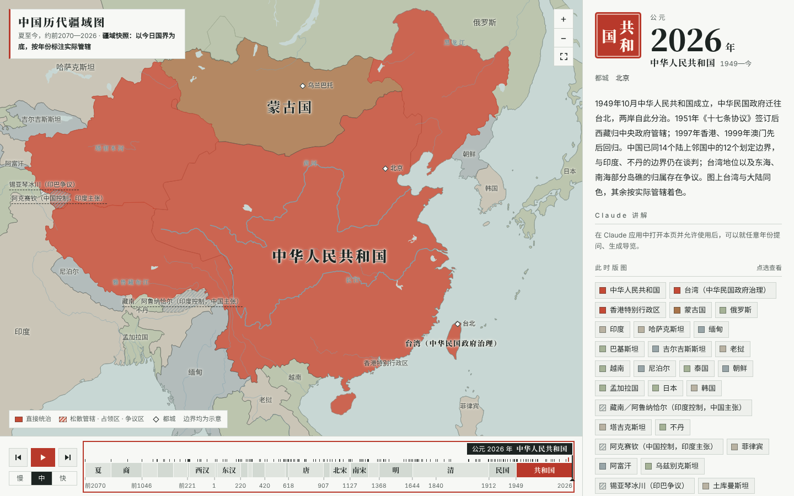

# 中国历代疆域图

可拖动时间轴查看的中国历史疆域地图，时间范围从夏（约公元前 2070 年）到 2026 年。



在线版本（Claude Artifact）：https://claude.ai/artifact/LxgZT3FPzzsHUG9VKCmE8m

## 功能

- 拖动时间轴逐年查看疆域变化，也可以播放（三档速度）、按朝代跳转、用方向键逐年移动。时间轴分段缩放：公元前 221 年以前压缩，1840 年以后放大。
- 地图可缩放、平移；点选政权查看简介，悬停高亮。
- 右侧面板随年份更新：朝代简介、都城、并立政权、大事记（166 条，点选跳转）。
- 实色表示直接管辖，斜纹表示都护府、羁縻、册封、占领区或争议地区。
- 深色模式、手机布局。
- 在 Claude 应用中打开时，还可以：就当前年份向 Claude 提问（Claude 能代为拖动时间轴）、生成某个朝代的四站导览、用 Claude 语音朗读。这些功能依赖 Claude Artifact 运行环境，直接用浏览器打开 `site/index.html` 时会自动隐藏。

## 本地查看

`site/` 是完整的静态网页，不需要构建：

```bash
npx http-server site -p 8080   # 或直接用浏览器打开 site/index.html
```

页面从 cdnjs 加载 d3 7.9.0 和 topojson 3.0.2。

## 重新生成地图数据

`site/data.js` 由脚本生成。需要 Python 3（shapely）和 Node.js。

```bash
pip install shapely
bash scripts/prepare.sh                                                   # 下载源数据到 data/
python3 scripts/build.py data/historical-basemaps/geojson data/ne build/geo  # 裁剪、校订、按年份组织
node scripts/topo.js                                                      # 简化为 TopoJSON，写入 site/data.js
python3 scripts/qa_frames.py mid 0 1 2                                    # 可选：把指定快照画成检查图
```

- `scripts/build.py`：每个时期的疆域快照和“年份 → 归属”表都在这里，改归属、改年代都改这个文件。
- `scripts/polities.json`：政权代号 → 中文名和配色槽位。
- 朝代简介、大事记、都城坐标写在 `site/index.html` 的脚本里（`PERIODS`、`EVENTS`、`CAPS`、`NOTES`）。

## 数据与画法说明

- 1912 年以前的政权轮廓改绘自 [historical-basemaps](https://github.com/aourednik/historical-basemaps)，按史实校订了归属和年代（原数据有若干标注错误，例如把 700 年的唐标成隋）。
- 三国分界、宋金分界、汉唐西域都护府范围、明代蒙古与女真分区、1937—1945 年日军占领区、中印争议地区为手绘示意。
- 1912 年以后以 [Natural Earth](https://www.naturalearthdata.com/) 的今日国界为底，按年份切换归属；台湾自 1949 年起与中国大陆同色，标注中说明由中华民国政府治理。南海诸岛、钓鱼岛和各租借地未标绘。
- 所有边界均为示意，不代表精确边界或对主权归属的判断。

## 许可

本仓库以 [GPL-3.0](LICENSE) 发布，因为地图数据改绘自以 GPL-3.0 发布的 historical-basemaps。Natural Earth 数据为公有领域。
